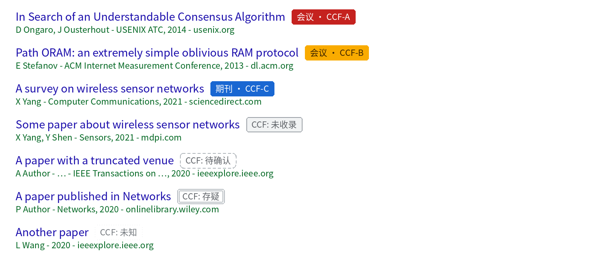

# Google Scholar CCF 等级

在谷歌学术搜索结果标题旁加一个徽章，显示该论文的 **CCF 推荐等级**（第七版，2026）和**期刊/会议**属性；不在目录里的明确标出，判断不了的也如实说"不确定"，会议名被截断时用条目自带的「引用」信息补全后再判定。



- 681 条目录数据内嵌在脚本里，**不联网**也能判级
- 结论分档：有等级（实心彩色）／未收录（实线）／待确认（虚线）／存疑（双线）／未知（点线）
- 会议名被截成 `…` 时自动补全，补不上就标 `待确认`，绝不硬说成"未收录"
- 名字太通用（`Networks`、`Cognition`）不硬判等级，标 `存疑` 并在悬停里给出疑似刊物
- 三点式匹配（全称 → 简称 → 特例），对 37 个非 CCF 干扰项零误报

## 安装

**一键安装**（装好油猴后点链接即可）：

<https://raw.githubusercontent.com/Mxd353/google-scholar-ccf/main/ccf-rank-google-scholar.user.js>

**本地安装**：把 `ccf-rank-google-scholar.user.js` 拖进浏览器窗口，确认安装。

油猴插件：[Tampermonkey](https://www.tampermonkey.net/) 或 [Violentmonkey](https://violentmonkey.github.io/)。

## 徽章

| 徽章 | 何时出现 | 样式 |
|---|---|---|
| `期刊 · CCF-A` / `会议 · CCF-A` | 命中目录 A 类 | 深红实心 + 白字 |
| `期刊 · CCF-B` / `会议 · CCF-B` | 命中目录 B 类 | 琥珀实心 + 深褐字 |
| `期刊 · CCF-C` / `会议 · CCF-C` | 命中目录 C 类 | 蓝色实心 + 白字 |
| `CCF: 未收录` | 名字读得出来，但确实不在目录里（arXiv、IEEE Access、LNCS、Nature、低水平会议等） | 浅灰底 + **实线**框 |
| `CCF: 待确认` | 名字被截断或缺失，且「引用」补全没成功 → 信息不全，不能断言 | 无底色 + **虚线**框 |
| `CCF: 存疑` | 名字恰好是目录里的通用单词（`Networks`、`Cognition`），无法确认指向哪本刊物 | 无底色 + **双线**框 |
| `CCF: 未知` | 条目里根本没有会议/期刊信息可读 | 无底色 + **点线**框 |
| `CCF: 查询中…` | 正在补全（通常不到一秒） | 无底色 + 点线框 |

灰色徽章按"确定程度"分四档，边框样式是第二重线索：**实线 = 确定的结论，虚线/双线/点线 = 程度不同的不确定**。文字本身也不一样，色弱或黑白打印时同样可读。

悬停看详情：命中项显示全称、学科领域、条目简称；`存疑`会给出"疑似"的那本刊物；`待确认`会附上谷歌学术的原始（截断）文本；补全成功过的会注明名称来源。

## 油猴菜单

| 菜单项 | 作用 |
|---|---|
| `切换样式：详细 / 紧凑` | 紧凑模式只显示 `CCF-A`、`N/A`、`?` |
| `重新扫描当前页面` | 清匹配缓存重标（引用结果仍复用缓存） |
| `标记非 A/B/C 的条目（未收录 / 待确认 / 存疑 / 未知）` | 开关，默认开；关掉后只标命中项 |
| `用「引用」补全被截断的会议/期刊名` | 开关，默认开；关掉后完全不发请求 |

## 工作原理

### 1. 识别会议/期刊

从结果 `.gs_a` 字段（`作者 - 会议/期刊, 年份 - 站点域名`）里切出中间那段，然后依次尝试：

1. **全称匹配**：文本归一化（去虚词、去年份、去复数、拆驼峰粘连）后做「词序列后缀对齐 + 覆盖率 ≥ 55%」比较，容忍 `Proceedings of the / 26th / IEEE / ACM` 之类前后缀。后缀 + 覆盖率这两条是为了不把 *“…Conference on Computer and Communication Systems”* 误判成 INFOCOM。
2. **简称匹配**：只认大写/驼峰 token（`SIGCOMM '20`、`NSDI 20`、`EuroSys`），避免把 *Networking* 这类普通单词当成刊物名。另补了 `USENIX ATC`、`KDD`、`PVLDB`、`NIPS` 等常用别名。
3. **特例兜底**：`Proceedings of the IEEE`、`Journal of the ACM` 归一化后只剩虚词，单独处理。

### 2. 补全被截断的会议名

谷歌学术会渲染成 `… - IEEE Transactions on …, 2020 - ieeexplore.ieee.org`，页面上没有完整文本。脚本借用每条结果自身的「引用」接口：

1. 只对「字段含 `…`」或「没有会议/期刊字段」的条目发请求，名字完整的条目不查；
2. 取 `output=cite` 页面，优先读 BibTeX 的 `journal` / `booktitle`，其次读 MLA 里的 `<i>会议名</i>`；都解析不出再退一步取 BibTeX 导出；
3. 拿到全名重新判级，徽章从 `查询中…` 升级为 `会议 · CCF-A`；**补全失败则标 `待确认`（不是 `未收录`）**，因为此时我们并不知道它是不是 CCF 刊物。

请求控制：每条间隔 800ms、单页最多 20 条、按 cluster 缓存（重复扫描不重复请求）；被拦（非 200）即放弃，不重试。

### 3. 已知局限

- 「引用」是谷歌内部接口，若被限流或要求人机验证，补全会静默失败；这类条目显示 `待确认`（而非 `未收录`），控制台有 `[CCF]` 前缀日志。
- 目录中同名不同类的少数条目（如 `Computer Graphics International` 与 `Computers & Graphics`）只能取一条，按高等级优先。
- 名称为纯通用单词的少数期刊（`Networks`、`Cognition`）不做匹配，显示 `存疑` 并在悬停里给出"疑似"刊物，而不是硬判等级或说成 `未收录`。

## 目录结构

```
ccf-rank-google-scholar.user.js   # 成品，安装这个
badge-preview.png                 # 徽章效果预览
icon-128.png / icon-64.png / icon-32.png   # 脚本图标源文件
build/
  ccf_template.js                 # 脚本源码（数据占位 /*__CCF_DATA__*/）
  build.py                        # 注入目录数据 + 图标，产出 .user.js
  gen_icon.py                     # 生成图标 PNG
  preview.py                      # 生成 README 效果图
```

## 构建与自定义

```bash
python3 build/build.py                     # 默认读 ~/.config/opencode/ccf-catalog-v7.md
python3 build/build.py path/to/catalog.md  # 或指定目录文件
```

- **更新目录**：改 `build/ccf_template.js` 的逻辑或直接重跑 `build.py`，数据以 `[简称, 全称, 类型, 等级, 领域]` 数组内嵌在 `CCF_RAW`。
- **换图标**：替换 `icon-128.png` / `icon-64.png` 后重跑构建；图标以 base64 内嵌为 `@icon` / `@icon64`，离线可用。也可改成外链 `// @icon https://…`。注意 `@icon` 只影响油猴管理面板里的脚本图标，浏览器工具栏图标属于扩展本身。
